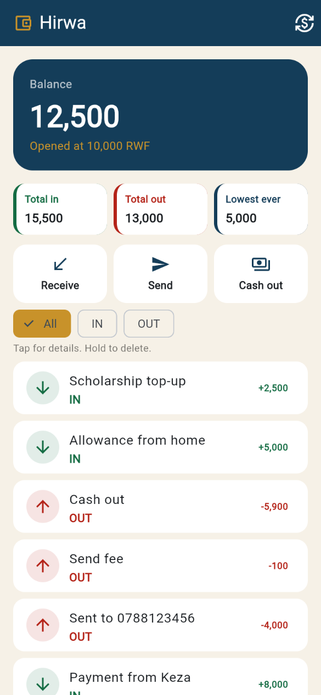
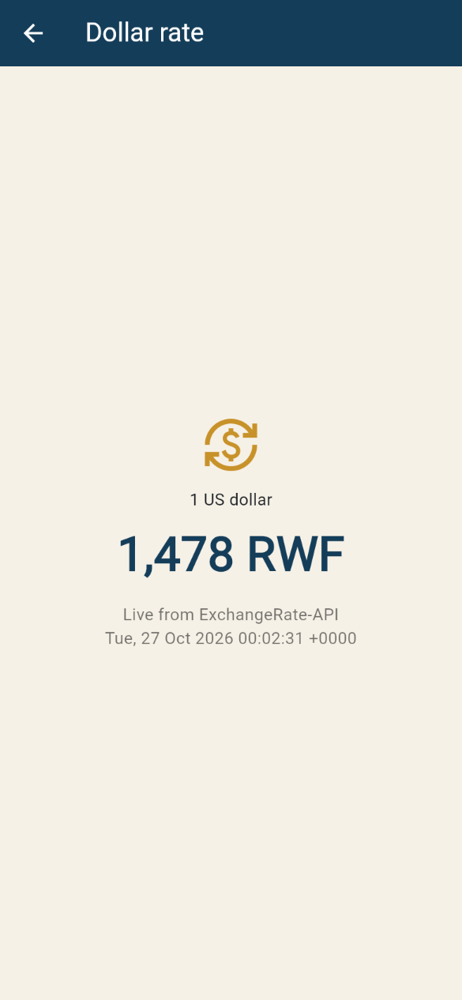
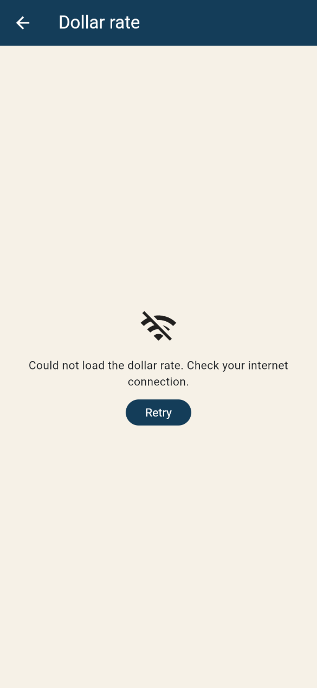

# Hirwa

A personal mobile-money wallet. Money comes in, money goes out, and the balance is worked out from the history, starting at 10,000 RWF.

## Download

The Android install file is not attached yet. After `flutter build apk --split-per-abi`, publish `app-arm64-v8a-release.apk` as a GitHub Release named Hirwa 1.0.0. The download link will be:

https://github.com/kmanasse/hirwa_wallet/releases/latest

## Features

- Sign in with email and password. Each account sees only its own transactions.
- Receive, send, and cash out. A send adds its own 100 RWF fee. Cash out shows the notes.
- The balance, total in, total out, and lowest balance are calculated. They are never stored.
- All, IN, and OUT filter the list. The balance stays on the full history.
- A delete that would push the balance below 0 is refused.
- The live value of 1 US dollar in Rwandan francs, with a clear message when there is no internet.

## Screenshots








## How it's built

Flutter, Firebase Auth, and Cloud Firestore. Provider holds one `WalletState` that every screen watches.

- `lib/models` says what a transaction is.
- `lib/repositories` is the only place that talks to Firestore or the dollar-rate API.
- `lib/state` holds the list, the filter, and the calculated figures.
- `lib/screens` only draws and calls the state class.
- `lib/utils` holds the wallet rules and colours.

## Run it yourself

```powershell
cd "D:\Documents\innovation\mobile programming\hirwa_wallet"
flutter pub get
flutter run -d chrome
```

Chrome opens the sample wallet until `google-services.json` is in `android/app/`. On a phone, create an account: that account's history is stored under `users/{id}/transactions`.

The dollar rate is the exchange icon in the top bar. With no internet, that screen shows the message and Retry.

## Author

[kmanasse](https://github.com/kmanasse), for Mobile Programming at the Innovation Center.
