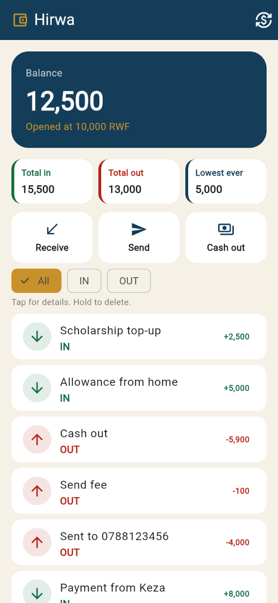
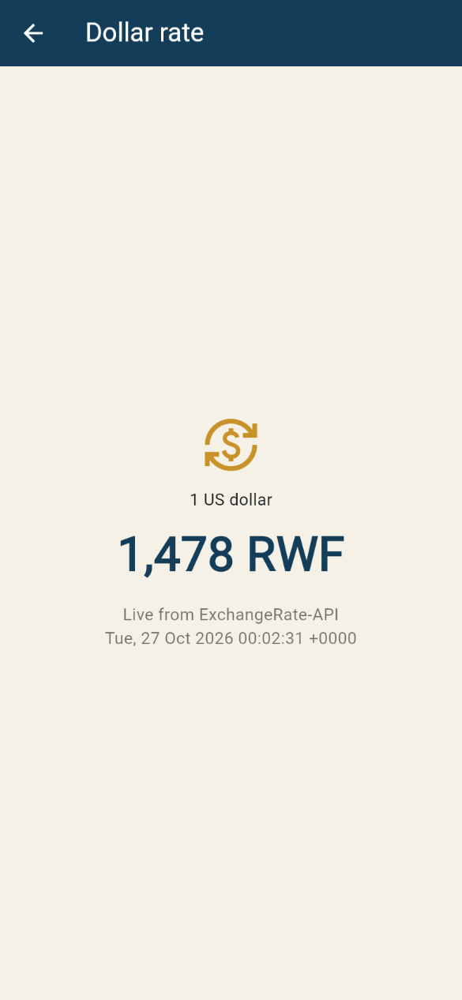
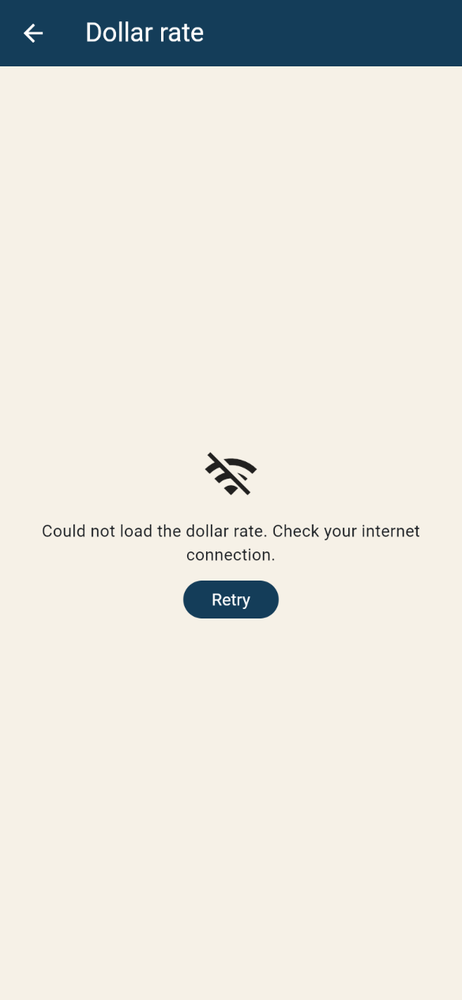

# Hirwa

A personal mobile-money wallet: money comes in, money goes out, and the balance is calculated from the history.

My data is now saved on the phone with shared_preferences, so nothing is lost when the app closes, and it shows the live value of 1 US dollar in Rwandan francs from ExchangeRate-API.

## Screenshots








## Run it

```powershell
cd "D:\Documents\innovation\mobile programming\hirwa_wallet"
flutter pub get
flutter run
```

The dollar rate is the exchange icon in the top bar. Pull the app closed and open it again: the history is still there. With no internet, that screen shows the message and Retry.
